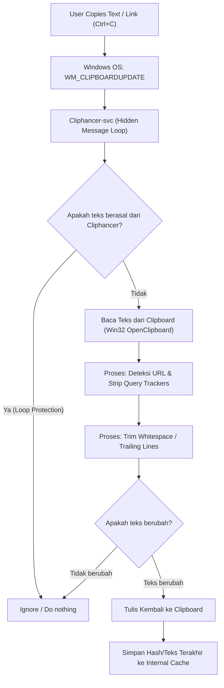

# Implementation Plan - Cliphancer-svc

Membangun aplikasi background service Windows yang ultra-ringan (**Rust**) untuk membersihkan link pelacak (*URL tracking parameters*) dan merapikan spasi/whitespace secara otomatis saat teks disalin ke clipboard pengguna.

## User Review Required

> [!IMPORTANT]
> - **Subsistem Windows GUI (`windows_subsystem = "windows"`):** Binary `cliphancer-svc.exe` akan berjalan 100% tanpa jendela konsol (tidak ada CMD pop-up hitam yang berkedip saat aplikasi dijalankan).
> - **Single-Instance Enforcement:** Menggunakan Win32 Named Mutex (`Global\CliphancerSvc_SingleInstanceMutex`) agar jika dijalankan berulang kali, tidak terjadi duplikasi proses di Task Manager.
> - **Folder Proyek:** `C:\Users\Administrator\Documents\Github Project\cliphancer-svc`
> - **Output Binary:** `cliphancer-svc.exe` (Release build via `cargo build --release`).

---

## Arsitektur & Cara Kerja

---

## Proposed Changes

### Proyek Baru: `C:\Users\Administrator\Documents\Github Project\cliphancer-svc`

#### [NEW] `Cargo.toml`
* Konfigurasi metadata proyek:
  * Nama package: `cliphancer-svc`
  * Target binary: `cliphancer-svc.exe`
  * Dependencies minimalis untuk menjaga ukuran RAM & binary sekecil mungkin:
    * `windows-sys` (atau crate Windows API minimalis untuk `OpenClipboard`, `GetClipboardData`, `SetClipboardData`, `AddClipboardFormatListener`, `CreateWindowExW`, `GetMessageW`, `CreateMutexW`)
    * `url` (untuk parsing query parameters URL yang aman dan standar RFC)
  * Profil release dengan LTO (`lto = true`, `opt-level = "z"`, `codegen-units = 1`, `strip = true`) untuk menghasilkan binary < 1 MB dan konsumsi RAM 1-3 MB.

#### [NEW] `src/cleaner.rs`
* Logika pembersihan teks:
  * **URL Tracker Stripper:**
    * Deteksi URL dalam teks (`http://` dan `https://`).
    * Menghapus parameter tracking umum:
      * Google Analytics: `utm_source`, `utm_medium`, `utm_campaign`, `utm_term`, `utm_content`, `gclid`, `gbraid`, `wbraid`
      * Meta / Facebook / Instagram: `fbclid`, `igshid`, `igsh`
      * YouTube: `si`, `feature`, `pp`
      * Twitter / X: `s`, `t`, `ref_src`, `ref_url`
      * TikTok / Bilibili / Marketplace: `_r`, `_t`, `spm`, `scm`
      * Email marketing: `mc_cid`, `mc_eid`, `vero_id`
  * **Whitespace Normalizer:**
    * Menghilangkan trailing whitespace di akhir baris dan spasi kosong tak perlu di ujung teks.
  * **Loop & Mutex Protection:**
    * Membandingkan hasil teks sebelum dan sesudah diproses; jika identik, clipboard tidak ditulis ulang agar tidak memicu overhead atau crash loop.

#### [NEW] `src/clipboard.rs`
* Implementasi native Windows API:
  * Membuka clipboard secara aman dengan retry loop singkat (karena aplikasi lain seperti Word/Excel kadang mengunci clipboard sesaat).
  * Pembacaan format `CF_UNICODETEXT`.
  * Penulisan kembali string UTF-16 yang telah dibersihkan.

#### [NEW] `src/main.rs`
* Titik masuk aplikasi:
  * Inisialisasi Win32 Named Mutex untuk memastikan hanya ada 1 instance berjalan.
  * Membuat invisible message-only window (`HWND_MESSAGE`).
  * Mendaftarkan listener clipboard via `AddClipboardFormatListener(hwnd)`.
  * Memulai event loop `GetMessageW` / `DispatchMessageW` yang tertidur (*zero CPU usage*) hingga ada event `WM_CLIPBOARDUPDATE`.
  * Pembersihan saat aplikasi ditutup (`RemoveClipboardFormatListener`).

---

## Verification Plan

### Automated Tests
* Unit test fungsi cleaner:
  * Pengujian penghapusan parameter YouTube: `https://youtu.be/xyz?si=12345` -> `https://youtu.be/xyz`
  * Pengujian parameter UTM: `https://example.com/page?utm_source=twitter&utm_medium=cpc&id=99` -> `https://example.com/page?id=99`
  * Pengujian whitespace: teks dengan spasi berlebih di awal/akhir baris.
  * Perintah: `cargo test`

### Manual Verification
1. Jalankan `cliphancer-svc.exe`.
2. Buka Task Manager: periksa penggunaan RAM (target: < 4 MB) dan pastikan tidak ada jendela konsol yang muncul.
3. Buka browser atau aplikasi apapun, salin link dengan tracker (misal: `https://www.youtube.com/watch?v=dQw4w9WgXcQ&si=trackingcode123`).
4. Lakukan Paste (`Ctrl+V`): pastikan link yang terpelihara bersih tanpa `&si=...`.
5. Salin teks biasa: pastikan fungsi copy-paste normal tidak terganggu dan tidak terjadi flickering/lag.
